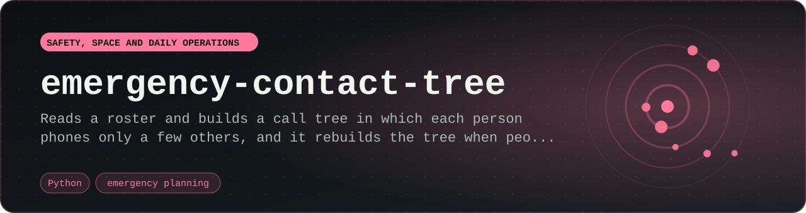
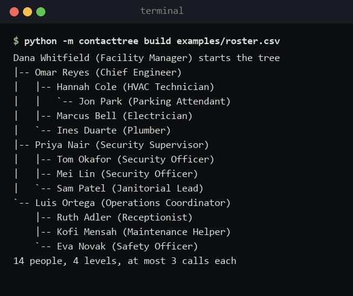

<p align="center"></p>

# emergency-contact-tree

[](https://github.com/yassine2med/emergency-contact-tree/actions/workflows/ci.yml)  

When something goes wrong in a building, one person phoning twenty others wastes the first minutes. This tool reads a roster and builds a call tree in which each person phones only a few others, and it rebuilds the tree when people are away.



## What it is for

Facility managers and safety officers keep emergency rosters, but a flat list does not say who calls whom. Use this tool to produce a clear tree for an evacuation, outage or severe weather plan, to check how many levels a message needs to reach everyone, and to regenerate the tree on the day with the people who are actually absent. The sample roster is invented and has no phone numbers; add contact details to your own printed copy.

## Install

```
git clone https://github.com/yassine2med/emergency-contact-tree
cd emergency-contact-tree && pip install -r requirements.txt
```

## How to use

| I want to | Command |
|---|---|
| Print the call tree | `PYTHONPATH=src python -m contacttree build examples/roster.csv` |
| Each person calls up to 4 others | `PYTHONPATH=src python -m contacttree build examples/roster.csv --fanout 4` |
| Rebuild without people who are away | `PYTHONPATH=src python -m contacttree build examples/roster.csv --absent "Omar Reyes,Jon Park"` |
| List caller and callee pairs as CSV | `PYTHONPATH=src python -m contacttree build examples/roster.csv --format csv` |
| Check a roster for problems | `PYTHONPATH=src python -m contacttree check examples/roster_with_errors.csv` |
| Show help | `PYTHONPATH=src python -m contacttree --help` |

Example:

```
PYTHONPATH=src python -m contacttree build examples/roster.csv
```

Output:

```
Dana Whitfield (Facility Manager) starts the tree
|-- Omar Reyes (Chief Engineer)
|   |-- Hannah Cole (HVAC Technician)
|   |   `-- Jon Park (Parking Attendant)
|   |-- Marcus Bell (Electrician)
|   `-- Ines Duarte (Plumber)
|-- Priya Nair (Security Supervisor)
|   |-- Tom Okafor (Security Officer)
|   |-- Mei Lin (Security Officer)
|   `-- Sam Patel (Janitorial Lead)
`-- Luis Ortega (Operations Coordinator)
    |-- Ruth Adler (Receptionist)
    |-- Kofi Mensah (Maintenance Helper)
    `-- Eva Novak (Safety Officer)
14 people, 4 levels, at most 3 calls each
```

Run the tests with `python -m pytest -q`.

## How it works

1. The roster CSV has name, role, team, rank and lead. Empty names, duplicate names and non-numeric ranks are reported.
2. The root is the person marked lead, or the best ranked person if nobody is marked.
3. People are taken in rank order. The root calls the next group of up to `--fanout` people (default 3), then each of those calls the next group, level by level.
4. Every present person is called by exactly one caller. Absent people are removed first, so a missing lead hands the root to the next person.
5. The last line reports how many people, how many levels and the most calls any one person makes.

## Limits

- Ranks decide who calls whom; it does not group by team or location.
- No phone numbers or messages are stored or sent. It only draws the tree.
- If a caller is unreachable, the tree is not rebuilt automatically: rerun it with `--absent`.

## License

MIT. Yassine Emhamed, 2026.
